# Sabuj Plant House

The frontend of a neighbourhood plant nursery in Kolkata: shop, product pages, checkout, OTP accounts, order tracking and care guides. Every plant has a goofy code-drawn mascot, and a 3D monstera sits in the hero. Vanilla JS runs on a mock API, so the backend can be attached later by changing one flag.

[](https://developer.mozilla.org/docs/Web/HTML)
[](https://developer.mozilla.org/docs/Web/CSS)
[](https://developer.mozilla.org/docs/Web/JavaScript)
[](https://threejs.org/)
[](https://lucide.dev/)
[](https://sayandeep1013.github.io/Sabuj-PlantHouse/)
[](LICENSE)

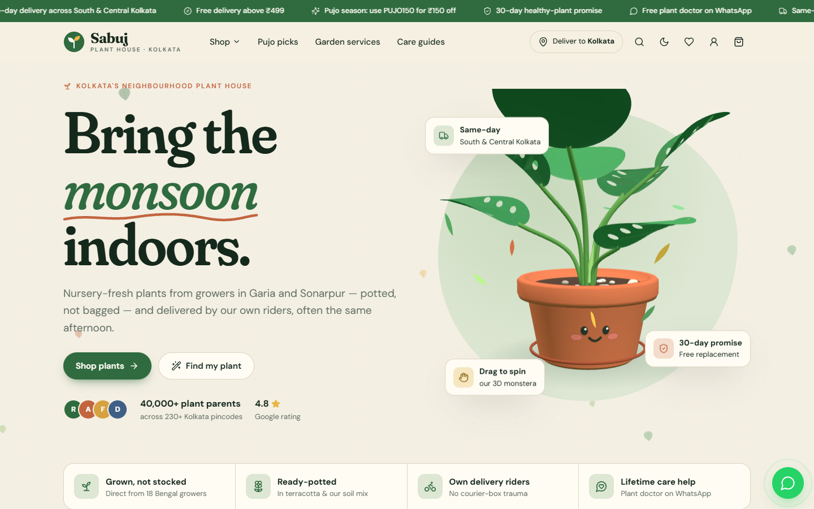

No framework, no build step, no dependencies to install. Open `index.html` and it runs.

**Live:** [sayandeep1013.github.io/Sabuj-PlantHouse](https://sayandeep1013.github.io/Sabuj-PlantHouse/)

---

## Screenshots

| Categories — illustrations as icons | Bengal's seasons, with what to plant now |
|---|---|
| 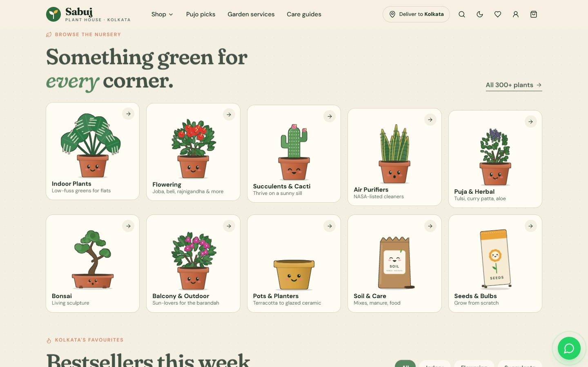 | 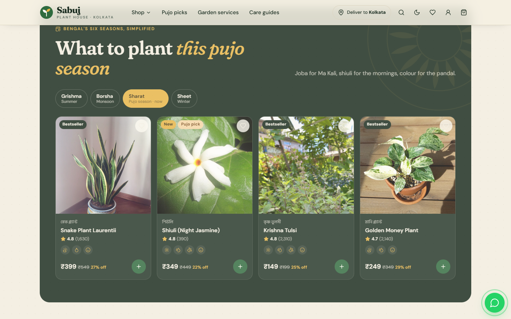 |

| Plant finder — three questions, three matches | Shop with filters, all state in the URL |
|---|---|
| 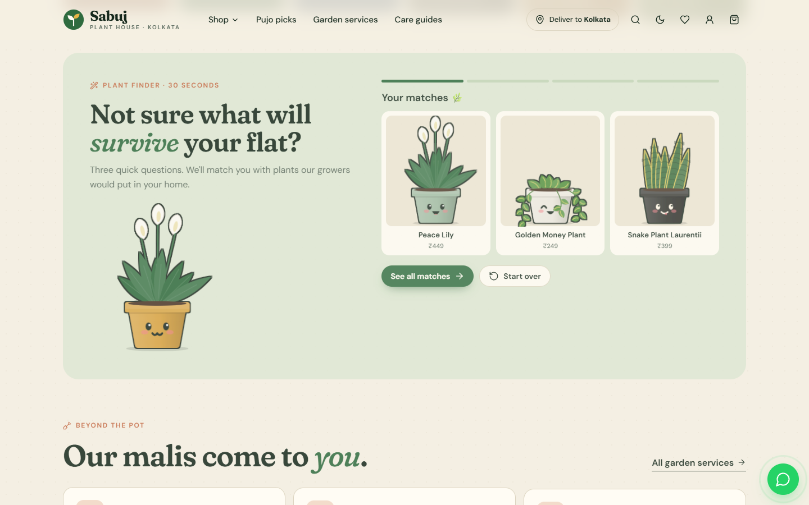 | 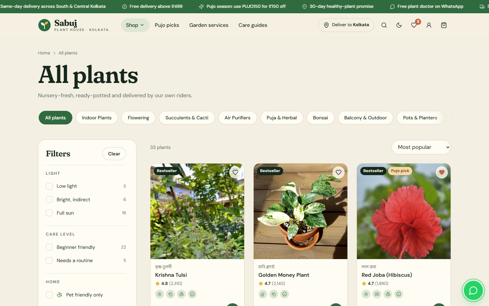 |

| Shop dropdown — every category, one click away | Product — sizes, live pot-colour preview |
|---|---|
| 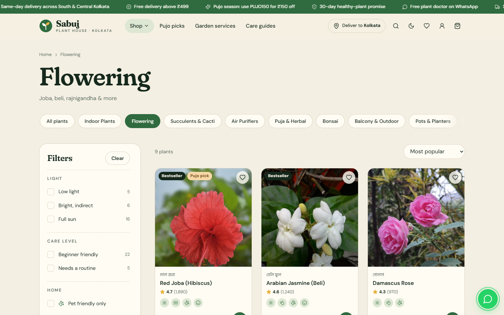 | 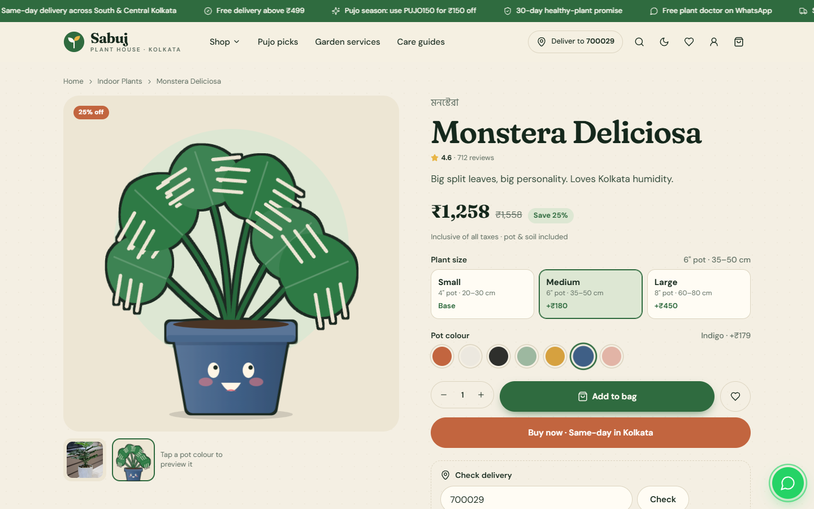 |

| Checkout — coupons, slots, saved address | Order tracker — the plant walks home |
|---|---|
| 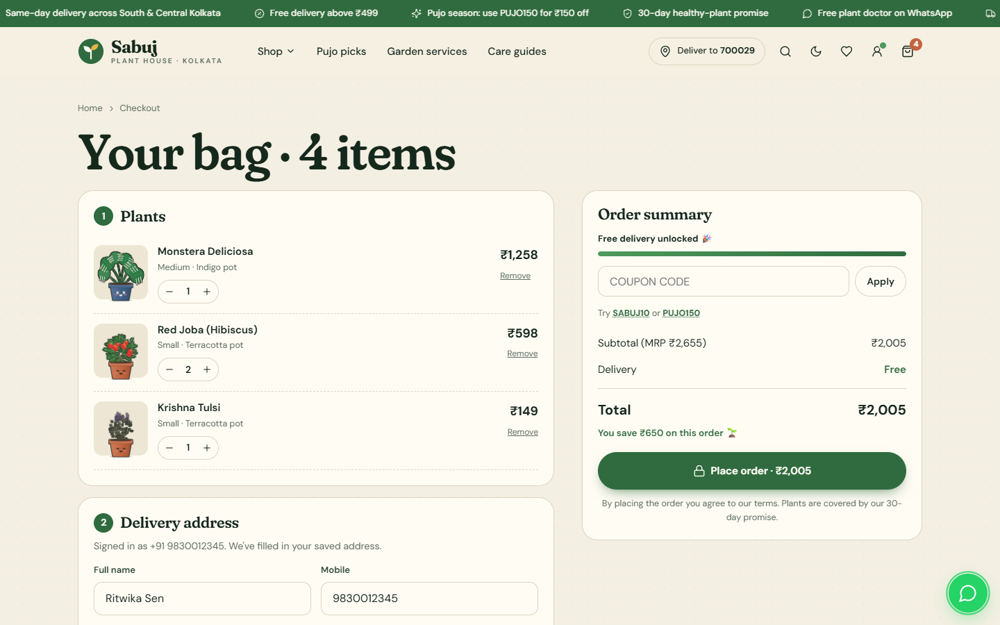 | 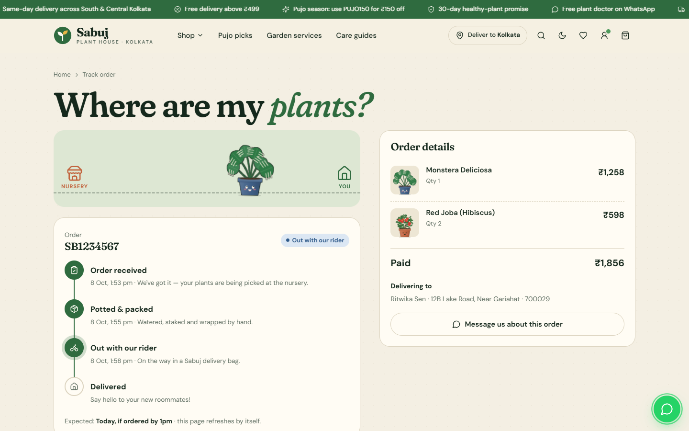 |

| Account — orders with reorder | Care guide article |
|---|---|
| 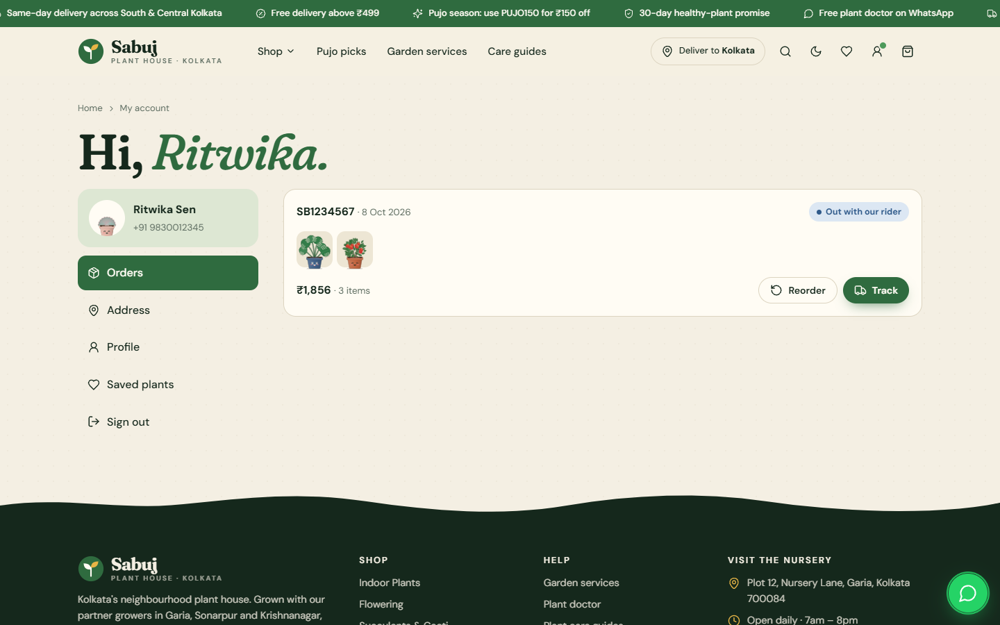 | 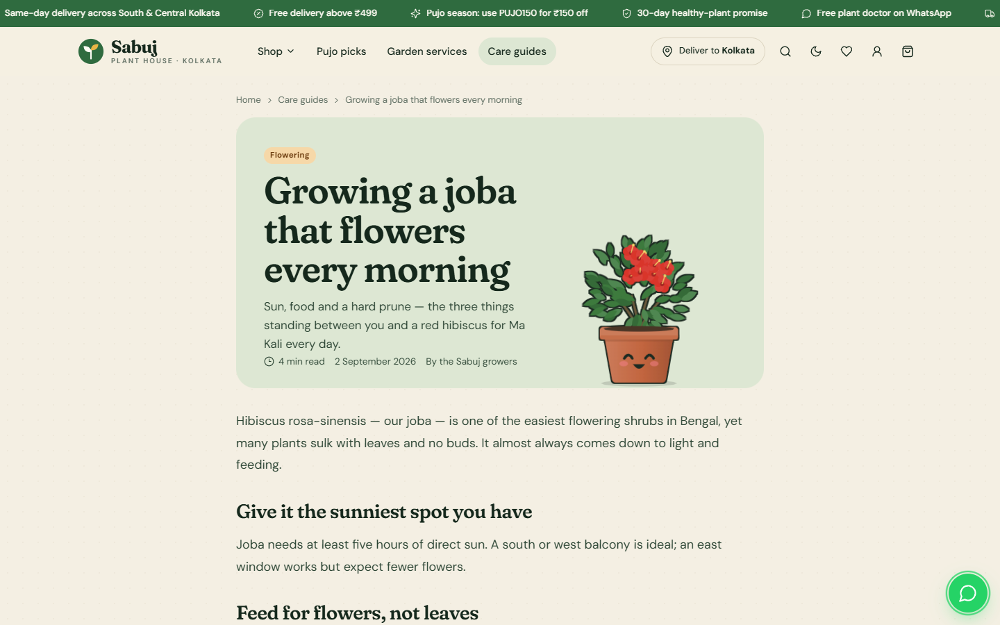 |

| Illustration library | Dark theme |
|---|---|
| 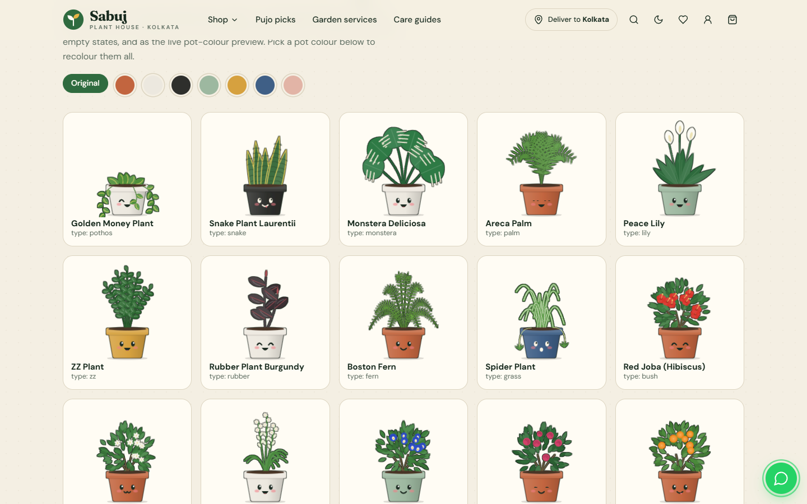 | 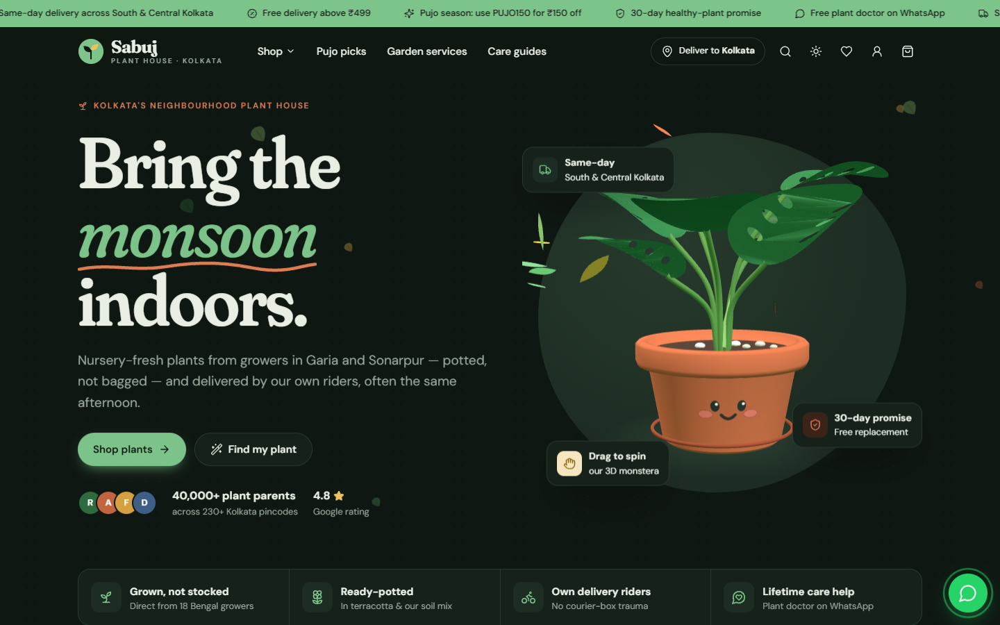 |

| Dark shop | |
|---|---|
| 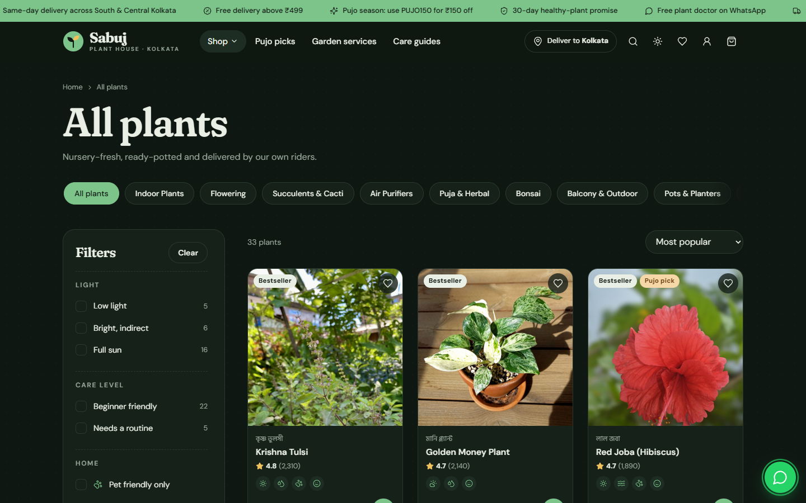 | |

**On a phone**

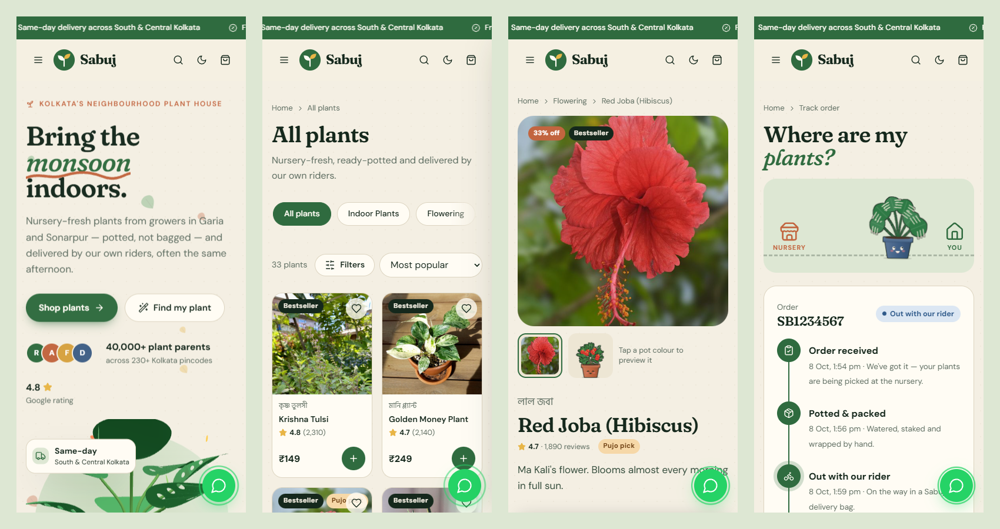

---

## How it works

- **One data layer.** Every page talks to `Api.*` in `assets/js/api.js`. With `USE_MOCK: true` the answers come from local data files after a short artificial delay. With `false` the same calls hit REST endpoints under `API_BASE`. The pages do not know the difference.
- **Pages are shells.** Each HTML file holds placeholders and one page script. Header, footer, cart drawer, search, pincode modal and toasts are injected by `ui.js`, so all eleven pages share one navigation and one cart.
- **The cart is an event, not a framework.** `Store` keeps the cart and wishlist in `localStorage` and fires `store:change`. Badges, the drawer and checkout all just listen for it, so moving the cart to a server means swapping the methods inside `Store`.
- **Filters live in the URL.** `shop.html?category=flowering&pet=1&light=bright` is shareable and survives a refresh. The quiz on the home page simply builds one of these links.
- **Content never waits on an animation.** Sections fade in on scroll, but anything already on screen is revealed immediately, so a slow observer can never leave the product grid blank.

```js
const { items, total } = await Api.listProducts({ category: "flowering", pet: 1, sort: "rating" });
Store.add({ id: "p10", name: "Red Joba", unit: 299, size: "s", pot: "terracotta" });
document.addEventListener("store:change", updateBadges);
```

---

## The goofy illustrations

Product photos show the real plant. Everywhere else — category tiles, the Shop dropdown, cart thumbnails, search results, the quiz, empty states, the tracker — a plant is drawn by `art.js` as a cartoon with a face on its pot.

- **Procedural, not drawn by hand.** Each product carries a small spec such as `{ type: "bush", leaf: "#3C7A3E", flower: "#D9342B", style: "five" }`. Twenty plant types (monstera, snake plant, trailing money plant, palm, fern, lily, ZZ, rubber, cactus, barrel, succulent, jade, aloe, bonsai, bamboo, flowering bush, tuberose spikes, herbs, croton, planters, soil bags, seed packets) are composed from four leaf primitives and a quadratic-curve walker.
- **Seeded.** A hash of the product id seeds the randomness, so a plant looks the same on every page and every visit.
- **Faces with moods.** Smile, grin, tongue, cat mouth, happy eyes or "wow", picked per plant. Eyes blink on a random offset, and the mouth swaps to a grin on hover. On dark pots the features flip to light so they stay visible.
- **Sticker outline.** One SVG filter (`feMorphology` dilate → flood → merge) draws an ink outline around the whole silhouette instead of stroking every leaf.
- **Live pot colour.** On the product page, choosing a pot colour redraws the plant in that pot.

The 3D hero follows the same idea in Three.js: a lathe-turned pot, monstera leaves cut from `THREE.Shape` with real holes for the fenestrations, and a canvas-texture face on a curved patch that blinks and grins while you drag it. Without WebGL it falls back to the SVG version.

---

## Pages

| Page | What it does |
|---|---|
| `index.html` | 3D hero, categories, bestsellers, Bengali-season picks, shop by space, plant finder, services, comparison table, reviews, delivery map with pincode check, care guides, FAQ, newsletter |
| `shop.html` | Filters for light, care, pets, price, space and season; sort, search and wishlist view |
| `product.html?p=<slug>` | Photo and pot-colour preview, size and pot variants, delivery check, care meters, tabs, related plants, sticky buy bar on mobile |
| `cart.html` | Cart, validated address form, delivery slots, payment choice, coupons (`SABUJ10`, `PUJO150`, `FIRSTLEAF`), confetti on success |
| `account.html` | Mobile + OTP sign-in, then orders with reorder, saved address, profile, saved plants |
| `track.html?id=<orderId>` | Status timeline and the walking plant; without an id, a lookup by order ID and mobile |
| `guides.html`, `guide.html?g=<slug>` | Six Kolkata-specific care guides with topic filter, grower's tips and "shop this guide" |
| `services.html` | Balcony makeovers, mali visits, plant doctor, corporate gifting, and a booking form |
| `illustrations.html` | Every illustration, recolourable by pot |
| `credits.html` | Attribution for the product photos |

---

## Connecting a backend

1. In `assets/js/config.js` set `USE_MOCK: false` and point `API_BASE` at the server.
2. Implement these endpoints. Response shapes match the objects in `assets/js/mock-data.js` and `guides-data.js`.

| Method | Path | Returns |
|---|---|---|
| GET | `/products?q=&category=&space=&season=&light=low,medium&care=easy&pet=1&tag=&ids=&maxPrice=&sort=popular\|rating\|price-asc\|price-desc\|discount&limit=` | `{ items: Product[], total }` |
| GET | `/products/:slugOrId` | `Product`, 404 if missing |
| GET | `/categories` | `Category[]` |
| GET | `/meta` | `{ spaces, seasons, areas, services, faqs }` |
| GET | `/testimonials` | `Testimonial[]` |
| GET | `/delivery/check?pin=700091` | `{ ok, zone, eta, cod, area }` or `{ ok:false, message }` |
| POST | `/coupons/validate` `{ code, subtotal }` | `{ ok, code, discount, label }` or `{ ok:false, message }` |
| POST | `/orders` | `{ ok, orderId, eta }` |
| GET | `/orders` | the signed-in user's `Order[]`, each with `status` and `timeline` |
| GET | `/orders/:id?phone=` | one `Order`; guests must pass the phone used to order |
| POST | `/auth/otp` `{ phone }` | sends a one-time code by SMS/WhatsApp → `{ ok }` |
| POST | `/auth/verify` `{ phone, code }` | `{ ok, user }` and a session cookie |
| GET / PATCH | `/auth/me` | current user, or update `{ name, email, tips, address }` |
| POST | `/auth/logout` | ends the session |
| GET | `/guides?topic=&limit=` · `/guides/:slug` | `Guide[]` / `Guide` |
| POST | `/services/bookings` `{ service, name, phone, area, date, message }` | `{ ok, ref }` |
| POST | `/newsletter` `{ email }` | `{ ok }` |

**Product** — `id, slug, name, local (Bengali name), categories[], price, mrp, rating, reviews, light, water, care, pet, spaces[], seasons[], tags[], short, image, art (optional), noVariants`.
**User** — `id, phone, name, email, tips, address { name, phone, line1, area, pincode }`.
**Order** — the body below plus `id, createdAt, eta, status (placed|packed|out|delivered), timeline: [{ status, done, at }]`.
**Guide** — `slug, title, kicker, topic, mins, date, excerpt, art, products[], body[]`, each block `["h"|"p"|"tip", text]` or `["list", [items]]`.

```json
{
  "items": [{ "productId": "p03", "size": "m", "pot": "indigo", "qty": 2, "unitPrice": 1258 }],
  "address": { "name": "", "phone": "", "line1": "", "area": "", "pincode": "700029" },
  "gift": { "note": "" },
  "slot": "today-eve | tmr-morn | tmr-eve",
  "payment": "upi | card | cod",
  "coupon": "PUJO150",
  "totals": { "sub": 0, "disc": 0, "ship": 0, "total": 0 }
}
```

The server must recalculate prices and totals itself; the client's figures are for display only.

**Mock mode:** the OTP is always `1234` and the page says so. Orders and the user live in `localStorage`, and an order's status advances with time since it was placed (2 min → packed, 5 → out, 12 → delivered), so the tracker has something to show.

---

## Design system

| Token | Light | Dark |
|---|---|---|
| Ground | `#F4EFE3` paper with a faint dot grid | `#0F1712` |
| Surface | `#FFFCF4` | `#16211A` |
| Ink | `#15281C` | `#E9EFE4` |
| Leaf (primary) | `#2F6B3F` | `#7CC48A` |
| Clay (accent) | `#C2653F` | `#E07E55` |
| Sun (highlight) | `#E8B546` | `#F0C25C` |
| Deep (footer, season band) | `#15281C` | `#1A2B20` — always dark, always light text |
| Display | Fraunces, with the `SOFT` and `WONK` axes on | |
| Body | DM Sans | |
| Bengali | Hind Siliguri | |

The dark theme follows the system and can be toggled from the header; the choice is remembered. Every scrollable strip uses one thin, low-contrast scrollbar, and chip rows hide theirs and fade at the edge instead. `prefers-reduced-motion` turns off the sway, blink, marquee, falling leaves and scroll reveals.

---

## Stack

| Layer | Technology |
| --- | --- |
| Markup | Eleven static HTML pages |
| Styling | One hand-written stylesheet, CSS custom properties for both themes |
| Runtime | Vanilla JS: a data layer, a shared UI module and one script per page |
| Illustration | Procedural inline SVG (`art.js`) |
| 3D | Three.js r128 from cdnjs, geometry built in code with no model files |
| Icons | Lucide from unpkg |
| Photos | Wikimedia Commons, resized to 800px JPEG |
| Hosting | GitHub Pages via GitHub Actions |

---

## Project structure

```txt
index.html … track.html   eleven pages, each a shell plus one page script
assets/
  css/style.css           the whole design system, light and dark
  img/products/           product photos (see credits.html)
  js/config.js            brand, contact, pot colours, sizes, USE_MOCK / API_BASE
  js/mock-data.js         catalogue, categories, seasons, areas, coupons, FAQs
  js/guides-data.js       care-guide articles (stand-in for a CMS)
  js/image-credits.js     author, licence and source for every photo
  js/api.js               Api.* data layer, mock auth/orders, Store (cart + wishlist)
  js/art.js               procedural plant illustrations, faces, sticker outline
  js/hero3d.js            the Three.js monstera
  js/ui.js                header, Shop dropdown, footer, drawer, search, toasts, cards
  js/pages/*.js           one script per page
screenshots/readme/       the images in this file
.github/workflows/        Pages deploy
```

Placeholder business details (brand, phone, WhatsApp, address) and the pot colours and size pricing live in `config.js`.

---

## Local setup

Any static server works. There is nothing to build.

```bash
python -m http.server 5180    # → http://localhost:5180
```

Opening `index.html` straight from disk also works. Data files are plain scripts rather than `fetch`ed JSON, so `file://` is fine.

---

## Notes

- **Kolkata, specifically.** Pincode checks know 7000xx from Howrah from the rest of Bengal. The season band follows Bengal's calendar (Grishma, Borsha, Sharat, Sheet) and opens on the current one. Plants carry their Bengali names, and the delivery map draws the Hooghly.
- **Images.** Photos are downloaded and stored in the repo rather than hotlinked, and every card falls back to its illustration if a photo fails to load.
- **Header width.** The content column tops out at 1216px, so the header was designed for that width rather than for the window. Categories moved into the Shop dropdown, the icons never shrink, and the delivery pill shortens below 1280px.

## Licence

MIT for the code. Product photos are from Wikimedia Commons under their own licences (CC BY, CC BY-SA, CC0, public domain). Each one is credited on [`credits.html`](https://sayandeep1013.github.io/Sabuj-PlantHouse/credits.html) with its author and source. Fonts are under the OFL, Lucide under ISC, and Three.js under MIT.
